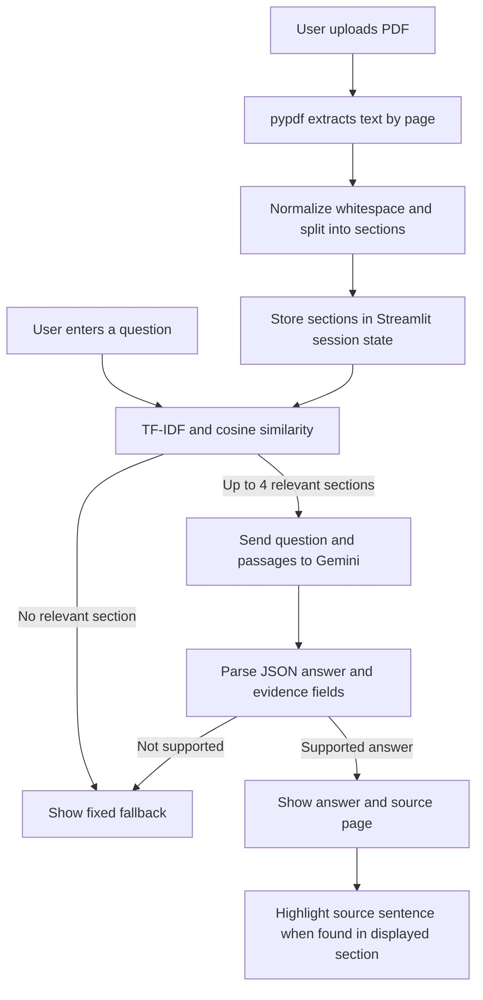

# Doc Retrieval Agent

> **Ask a PDF. Get a concise answer grounded in its pages.**

Doc Retrieval Agent is a small Python and Streamlit application for asking questions about a text-based PDF. It extracts the document's text, finds relevant passages locally, and asks Google's Gemini API to answer using only those passages. When the evidence does not support an answer, the app displays a fixed fallback instead.

The project is a single-process web app, not a voice assistant or a general-purpose chatbot. Its current interface accepts typed questions; it has no database, user accounts, or public application API.

## Contents

- [What it does](#what-it-does)
- [Technology](#technology)
- [Repository layout](#repository-layout)
- [How it works](#how-it-works)
- [Requirements](#requirements)
- [Install and run](#install-and-run)
- [Using the app](#using-the-app)
- [API and configuration reference](#api-and-configuration-reference)
- [Limitations and troubleshooting](#limitations-and-troubleshooting)
- [Security and privacy](#security-and-privacy)
- [Contributing](#contributing)
- [License and credits](#license-and-credits)

---

## What it does

### Core features

- Upload a PDF through the Streamlit interface.
- Extract selectable text and divide it into searchable sections of up to 180 words, retaining each section's page number.
- Rank sections locally with TF-IDF and cosine similarity.
- Send up to four relevant sections to Gemini for a document-grounded answer.
- Show the latest answer's source sentence and page, and highlight the matching sentence in the displayed document text when it is present.
- Return the same fallback when retrieval finds no sufficiently similar passage or Gemini says the evidence is insufficient:

  > This information is not mentioned in the document. Please contact the team.

### Typical uses

The app can help a person look up information in text-based guides, policies, reports, manuals, or other PDFs without manually searching every page. It is most useful when the uploaded document has extractable text and the question uses terms that overlap with the relevant passage.

### Not implemented

An earlier project note described voice input, speech transcription, text-to-speech playback, and call-style controls. Those features are **not implemented in the current `app.py`**. `pyttsx3` is listed as a dependency and imported optionally, but is not used by the interface or answer flow.

---

## Technology

| Area | Technology | Role |
|---|---|---|
| Frontend and application server | Python, Streamlit | Renders the upload, document, question, and conversation interface; runs the application. |
| PDF processing | `pypdf` | Extracts text from PDF pages. |
| Local retrieval | scikit-learn (`TfidfVectorizer`, cosine similarity) | Ranks document sections against the user's question. |
| AI | Google Gen AI Python SDK and Gemini `gemini-3.8-flash` | Produces a concise answer from the retrieved passages. |
| Configuration | `python-dotenv`-style `load_dotenv` interface | Loads values from a local `.env` file when available; the dependency file declares the package as `dotenv`. |
| Database | None | Uploaded documents and conversation messages are kept in Streamlit session state, not persisted in a database. |
| Authentication | None | There are no application users or login flow. The Gemini API key authenticates outbound model requests. |
| Deployment | Local Streamlit server | No container, cloud deployment, or production server configuration is included. |
| Windows convenience | `run_windows.bat` | Creates/activates `venv`, installs requirements, and starts Streamlit. |

No separate frontend framework, backend API framework, or database service is used.

---

## Repository layout

The application source is intentionally small. The `venv/` and `.venv/` directories sometimes present in a checkout are local Python environments, ignored by Git, and are not project source.

```text
document_voice_agent/
├── app.py             # Streamlit UI, PDF extraction, retrieval, and Gemini call
├── requirements.txt   # Python package requirements
├── run_windows.bat    # Windows setup and launch helper
├── .gitignore         # Excludes virtual environments, secrets, and generated files
├── .env               # Optional local configuration; ignored by Git and not shipped
└── README.md          # Project overview and setup guide
```

### Main modules and communication

All application logic lives in `app.py`; there are no separate API, database, frontend, or utility modules.

1. The Streamlit page accepts a PDF and a typed question.
2. `extract_pdf()` uses `pypdf` to extract page text and create page-tagged sections.
3. `retrieve()` uses scikit-learn to rank sections locally.
4. `ask_gemini()` sends the question and selected sections to the Gemini API, then parses its JSON response.
5. Streamlit displays the answer and, when available, the source page and highlighted sentence.

---

## How it works



### Processing details

1. **Upload and extraction:** `extract_pdf()` reads the uploaded bytes with `PdfReader`. It collapses whitespace on each page, splits non-empty page text into sections of up to 180 words, and retains the page number.
2. **Local search:** `retrieve()` fits a `TfidfVectorizer` over the sections and the question, scores each section with cosine similarity, and returns at most four sections whose score is greater than `0.02`.
3. **Grounded generation:** `ask_gemini()` builds a prompt that instructs Gemini to rely only on those sections and return JSON containing `answer`, `source_text`, `page`, and `found`. The request uses temperature `0.1`.
4. **Answer handling:** If retrieval returns no sections, or the model response says the answer was not found, the app shows the fixed fallback. Otherwise, it displays the answer and source page.
5. **Session display:** The current Streamlit session holds the selected document sections and conversation. The interface displays up to the latest six question/answer pairs. Uploading a different filename clears the current conversation.

There is no SQL or other database interaction. The Gemini request is an outbound API call from the Python app; it is not an endpoint exposed by this project.

---

## Requirements

- Python with `venv` and `pip`.
- Internet access when installing packages and when sending a question to Gemini.
- A Google Gemini API key for answer generation.
- Windows users can use the provided `py` launcher and batch file; Linux/macOS users can use `python3` and a shell.

`requirements.txt` does not pin a Python version. Use a Python release supported by the package versions installed in your environment.

---

## Install and run

### Windows

From the project root in Command Prompt or PowerShell:

```powershell
py -m venv .venv
.\.venv\Scripts\Activate.ps1
python -m pip install --upgrade pip
python -m pip install -r requirements.txt
$env:GEMINI_API_KEY = "YOUR_GEMINI_API_KEY"
streamlit run app.py
```

PowerShell may block activation scripts depending on your execution policy. If so, use Command Prompt instead:

```bat
py -m venv .venv
.venv\Scripts\activate.bat
python -m pip install --upgrade pip
python -m pip install -r requirements.txt
set GEMINI_API_KEY=YOUR_GEMINI_API_KEY
streamlit run app.py
```

Alternatively, run the included helper from the project root:

```bat
run_windows.bat
```

The helper creates `venv` if it is missing, activates it, installs `requirements.txt`, and runs `streamlit run app.py`. Set `GEMINI_API_KEY` in the same terminal before launching it. The helper uses the environment-variable value available to its process.

### Linux and macOS

From the project root:

```bash
python3 -m venv .venv
source .venv/bin/activate
python -m pip install --upgrade pip
python -m pip install -r requirements.txt
export GEMINI_API_KEY="YOUR_GEMINI_API_KEY"
streamlit run app.py
```

Streamlit prints the local address when the server starts. Its default local port is `8501` when that port is available; open the `Local URL` printed in the terminal (commonly `http://localhost:8501`).

### Configure with `.env` (optional)

`app.py` calls `load_dotenv()`, so a local `.env` file can be used instead of setting the variable in each terminal. Create the file in the project root with:

```dotenv
GEMINI_API_KEY=YOUR_GEMINI_API_KEY
```

The real key is not included in this README. `.env` and `.env.*` are ignored by `.gitignore`; do not commit secrets.

---

## Using the app

1. Start the server using one of the commands above and open its local URL.
2. Choose a PDF with selectable/extractable text using **Upload a PDF document**.
3. Enter a question in **Ask about this document** and select **Ask**.
4. Read the answer and, when the model returns a supported source, check its page and the highlighted sentence.

The first question that reaches Gemini requires a valid `GEMINI_API_KEY`. If local retrieval finds no matching section, the fallback is shown without a Gemini request.

---

## API and configuration reference

### HTTP API

This project does **not** define a public REST or GraphQL API. Its supported interface is the Streamlit web UI. Streamlit uses internal mechanisms to serve that UI, but they are not application endpoints documented or maintained by this project.

### Configuration

| Setting | Required | Description |
|---|---:|---|
| `GEMINI_API_KEY` | For Gemini answers | API key read by `ask_gemini()` from the process environment. It can also be loaded from the project-root `.env` file. |
| Gemini model | No separate setting | The model is currently set in `app.py` to `gemini-3.8-flash`. |
| Streamlit port | No | Not configured by the app; Streamlit uses its standard default when available. |

No database URL, authentication credentials, or other application environment variables are read by the current code.

---

## Limitations and troubleshooting

| Symptom | Likely reason | What to try |
|---|---|---|
| `GEMINI_API_KEY is not set.` | The variable was not available to the process running Streamlit. | Set it in the same terminal before starting the app, or add it to a local `.env` file. Restart Streamlit after changing the environment. |
| Gemini request fails | The key may be invalid, the network unavailable, or the configured model/API may not be available to the account. | Check the key and network access, and verify model availability with the Google Gen AI service. The app displays the caught error in the UI. |
| The app returns the fallback for a relevant topic | The PDF may not have extractable text, retrieval may not find a passage above its similarity threshold, or the selected passages may not explicitly support the answer. | Try a text-based PDF and ask a more specific question using terms found in the document. |
| Scanned pages produce no useful text | The app extracts embedded PDF text but does not run OCR. | Use a PDF with a text layer; OCR support would need to be added separately. |
| `streamlit` or another module cannot be found | The packages were installed into a different Python environment. | Activate the environment first, then run `python -m pip install -r requirements.txt` and start Streamlit from that same terminal. |
| Port `8501` is already in use | Another Streamlit process is using the default port. | Stop the other process or start this app with a different Streamlit port, for example `streamlit run app.py --server.port 8502`. |

Other current limitations:

- PDF extraction quality depends on the document's text layer; image-only pages are not OCR'd.
- Retrieval is keyword-weighted TF-IDF rather than a semantic embedding index.
- Only the top four matching sections are sent to Gemini; relevant context outside those sections may be missed.
- The app has no persistent document store or chat history. Streamlit session state is used for the active session.
- Gemini output is requested as JSON, but malformed responses or API failures can still interrupt an answer.
- There is no automated test suite or deployment configuration in the project root.

### Possible future work (not implemented)

Potential improvements include OCR for scanned PDFs, automated tests for extraction and retrieval, and real speech input/output. These are suggestions only; they are not current features.

---

## Security and privacy

- Keep `GEMINI_API_KEY` in an environment variable or ignored local `.env` file. Never put it in source control or browser-side code.
- PDF extraction and TF-IDF ranking run in the Streamlit process. The selected question and up to four retrieved text sections are sent to Google's Gemini API for answer generation; do not use documents unless that data flow is acceptable for your privacy requirements.
- The app renders extracted PDF text in HTML using Streamlit's `unsafe_allow_html=True`. Only use documents you trust in the current version. If accepting untrusted PDFs, sanitize or safely escape extracted text before rendering it.
- The included app has no login or access control. Do not expose the development server to an untrusted network as-is.

---

## Contributing

There is no formal contribution guide or test suite in the repository. For a change:

1. Create and activate a virtual environment.
2. Install dependencies with `python -m pip install -r requirements.txt`.
3. Keep changes focused and avoid committing `.env`, virtual environments, or generated files.
4. Run `python -m py_compile app.py` for a basic syntax check and manually exercise the affected Streamlit flow.

If you propose a new capability, update this README so it reflects behavior implemented in the code rather than planned behavior.

---

## License and credits

No license file or author attribution is present in the project root, so this README does not claim a license or name an author. The application integrates Google's Gemini API; using it requires compliance with the applicable Google API terms.
